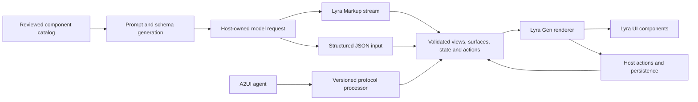

# Generative UI: Lyra Gen

Status: **`@aceshooting/lyra-gen` 1.0.0 is the stable release**; see its
[compatibility profile](../../packages/lyra-gen/docs/compatibility.md#criteria-for-10). Its numerical
timing and memory campaign follows the release, and opt-in region error isolation is not part of
1.0. The experimental [0.1.0 release](https://github.com/aceshooting/lyra-ui/releases/tag/lyra-gen%400.1.0)
preceded it. This roadmap preserves the complete program and
its acceptance criteria, including remaining work; original stage-version targets remain as
planning history. Website and hosted live generation remain pending and are sequenced last,
after the library work.

The objective is to make Lyra a leading foundation for interactive generated answers and persistent
application dashboards: useful earlier in a stream, responsive during interaction, reliable under
updates, accessible, localizable, and efficient to generate and deliver. Competitive leadership must
be established against named implementations and equivalent workloads, with published evidence.
OpenUI and A2UI are initial reference points; the comparison program also covers other generative
UI systems and conventional dashboard interactions where their capabilities overlap.

## Reading and status

- [Detailed capability backlog](generative-ui-backlog.md): every item in the 132-item initial
  inventory, with revised contracts, dependencies and acceptance evidence, plus dashboard additions.
- [Evaluation and performance](generative-ui-evaluation.md): comparison cohorts, source evidence,
  functional equivalence, measurement methods, qualification and sizing assumptions.
- [Website, showcases and live generation](generative-ui-website.md): launch marketing, the demo
  gallery, chat experience, source playground, live service and comparison pages.
- [Main roadmap](../roadmap.md): ordering against the existing library and companion programs.

The [implementation snapshot](generative-ui-backlog.md#current-implementation-snapshot) links
current source, scoped tests and limitations. The
[evaluation inventory](generative-ui-evaluation.md#current-implementation-and-evidence) separates
executed experiments from missing campaigns. A capability is accepted only when its own
implementation and qualification evidence are recorded.
An investigation result does not mark its eventual feature delivered. Existing component tests do
not qualify a new generated composition, and a demo does not qualify a complete protocol profile.
Backlog identifiers are stable references; merged approaches retain their identifiers and explain
the replacement. Conditional and deferred work remains visible instead of disappearing from scope.

## Product outcomes

### Interactive answers first

A host application supplies a model stream and an approved component catalog. One answer can mix
Markdown, charts, tables, citations, forms and actions. Users can interact while content arrives;
editing a form or filtering existing data should not require a model call. Follow-up requests alter
the intended portion of the answer while preserving user input, focus and unrelated content.

The first qualified catalog covers common chat outcomes, with roughly 25 component roles as a
planning guide rather than a fixed tag count. Composite controls may require several registered
tags. Catalog qualification, safe property contracts and useful scenarios determine inclusion.

Initial candidates to evaluate, grouped by role and not a commitment: key figures (`lr-stat`);
bar and line charts (`lr-lite-chart`); tables (`lr-table`); grouping (`lr-card`, `lr-details`,
`lr-tab-group`); status and emphasis (`lr-callout`, `lr-alert`, `lr-badge`, `lr-chip`,
`lr-progress-bar`, `lr-rating`); sequences (`lr-timeline`, `lr-stepper`); media and sources
(`lr-media-card`, `lr-source-card`, `lr-citation-badge`, `lr-code-block`); follow-ups
(`lr-suggestion-chips`); and form controls (`lr-button`, `lr-input`, `lr-textarea`, `lr-select`
with `lr-option`, `lr-checkbox`, `lr-radio-group`, `lr-switch`, `lr-slider`, `lr-date-input`).
Higher-level components matter for cost as well as quality: one labelled, validated input or one
key-figure tile replaces several primitive elements in the generated output.

### Saved dashboards inside applications

Generating a dashboard must produce a reusable application artifact. A user can save a definition,
return to it without generating it again, and place it in a host application's page, tab, dashboard
gallery or navigation entry. The saved document describes components, layout, bindings and allowed
actions; it does not embed executable model code, provider credentials or application authorization.

A host can let users publish dashboards for other users to view, edit or duplicate. Draft changes
remain separate from the currently published revision. Editors can inspect changes, restore an
earlier revision, or make an independent copy. Two editors writing against the same old revision
must receive an explicit conflict instead of silently losing one person's work.

Lyra Gen owns the portable document contract, renderer and integration APIs. The application owns
durable storage, identity, permissions, tenant boundaries, data access and publication policy.
An in-memory or browser-storage example is not evidence of multiuser persistence or authorization.
Real-time collaborative editing is a later investigation; saved sharing, revision conflicts and
authorized multiuser editing are part of the persistent-dashboard delivery.

### Competitive dashboard behavior

Go beyond generating a collection of charts. Planned dashboard capabilities include linked filters,
cross-widget selection, drill-down, query reuse, live data with cancellation and backpressure,
large-data views, layout editing and pinning, freshness and provenance indicators, revisions, undo
and export. Benchmark generation, subsequent edits, and direct interactions independently.

## Market and design references

The [comparison cohorts](generative-ui-evaluation.md#two-comparison-cohorts) name the libraries
enrolled for measured comparison. The products and patterns below are not benchmark comparators,
but they set user expectations or offer designs worth adopting. Descriptions summarize public
announcements and documentation; verify current behavior before relying on a detail.

| Reference | Relevant behavior | Consequence for Lyra Gen |
|---|---|---|
| Assistant products: Claude ([interactive connectors through MCP Apps](https://claude.com/blog/interactive-tools-in-claude), interactive visuals inside replies, artifacts and reported persistent dashboards that refresh connected data), ChatGPT Intelligent UI (announced 2026-10-07) and Gemini [dynamic view](https://research.google/blog/generative-ui-a-rich-custom-visual-interactive-user-experience-for-any-prompt/) | Answers mix prose with interactive elements; some generate custom code per answer; saved dashboards refresh data without regenerating the interface | Users will expect inline interactivity, persistent screens and data refresh without a new generation. Lyra Gen answers with a constrained, accessible catalog and keeps open-ended code in a separate, conditional sandboxed tier |
| [MCP-UI](https://mcpui.dev/guide/introduction) with [Shopify Remote DOM](https://shopify.engineering/remote-rendering-ui-extensibility) | Untrusted code runs in a sandbox and renders through the host's own component library | Basis for the conditional Remote DOM tier: open-ended flexibility rendered with Lyra components |
| [OpenAI ChatKit widgets](https://developers.openai.com/api/docs/guides/chatkit) | Declarative widgets whose actions can update the widget in place | Identity-addressed in-place updates; a visual widget playground |
| [Adaptive Cards templating](https://learn.microsoft.com/en-us/adaptive-cards/templating/) | Templates kept separate from data; host configuration controls styling; host-specific schema versions; plain-text fallback | Separate structure from data, negotiate host capabilities and always provide a fallback |
| [assistant-ui](https://www.assistant-ui.com/docs/tools/generative-ui) and [LangGraph generative UI](https://docs.langchain.com/langgraph-platform/generative-ui-react) | Tool-specific renderers by tool name; allowlisted JSON-spec message parts; components loaded by name on demand | Keep tool-specific result renderers first-class beside composition; load component code by name as it appears |
| [Flutter GenUI](https://docs.flutter.dev/ai/genui/components) | Catalog items defined by name, schema and builder; an A2UI connector | A minimal catalog-item contract for overlays |

## Starting point and current implementation

The table records the Lyra UI 30.2.0 starting point and the work it motivated. The companion now
implements restricted Markup/JSON input, reviewed catalogs, keyed generated views, native forms,
state/actions, chat composition and saved dashboard contracts. See the linked implementation
snapshot for the current boundaries; the original gaps below are not all still open.

| Area | Existing foundation | Required extension |
|---|---|---|
| Declarative rendering | `lr-widget-renderer` v2, immutable allowlisted registries, stable keys, controlled bindings and action events | Model-facing catalogs, validated structured properties and a generated-UI runtime |
| Chat | Markdown streaming, ordered message parts, tool results, interruption state and `renderPart` customization | Qualified generated islands, convenient registry/state integration and retained widget identity during sibling text updates |
| Stream state | Provider-neutral reducer, generation/sequence cursors, resource limits and snapshots | Avoid rescanning retained payloads for each text delta while preserving ownership and limit semantics |
| A2UI | An explicitly structural `A2UiLikeSurface` adapter | Versioned wire-protocol processing, surfaces, catalogs, data models, templates, functions and outbound actions |
| MCP App-style hosting | A bounded, isolated host using a library-specific bridge | Official MCP Apps negotiation, resources, host bridge, sandbox policy and lifecycle |
| Components | Existing form, data, chart, layout, retrieval and agent families | Safe generative catalog definitions and populated composition qualification |
| Dashboards | Layout and data components | Persistent documents, live bindings, sharing, application integration and collaborative revision semantics |
| Website | Existing component and feature pages | Live generation service, qualified demo surfaces and reproducible comparative evidence |

The structural adapter now supplies `bindingState` while retaining its legacy `state` alias.
`lr-message-parts` now forwards widget registry/state and memoizes unchanged widget documents;
the provider-neutral reducer has an incremental text-delta path. These changes have dedicated
regression fixtures. Structured generated properties live in the separately validated companion;
stable widget-v2 rejection and primitive-property boundaries remain compatible.

Source entry points: [AI adapters](../../packages/lyra-ui/src/ai/adapters/a2ui.ts),
[stream reducer](../../packages/lyra-ui/src/ai/runtime.ts),
[widget renderer](../../packages/lyra-ui/src/components/conversation/widget-renderer/widget-renderer.class.ts),
[registry](../../packages/lyra-ui/src/components/conversation/widget-renderer/registry.ts), and
[message parts](../../packages/lyra-ui/src/components/conversation/message-parts/message-parts.class.ts).

## Architecture

### Package boundary

`@aceshooting/lyra-gen` is an independently versioned companion at
`packages/lyra-gen`. Lyra UI is its required peer; Lyra UI must not import
the companion. Public integration APIs must avoid imports from another package's private internals.
Any necessary reusable library helper receives an intentional public contract and qualification.

| Owner | Responsibilities |
|---|---|
| Lyra UI | Components, existing widget-v2 contract, provider-neutral stream primitives and demonstrated reusable integration hooks |
| Lyra Gen | Format parsing, catalog overlays, prompt/schema generation, normalized view/runtime contracts, generated forms, diagnostics, persistence document and protocol adapters |
| Host application | Model/provider requests, transport, authentication, authorized data/tool access, storage, publication, permissions and side effects |
| Public website | Version-pinned examples, bounded demonstration service, inspectable output, marketing and measured evidence |

The implemented experimental `<lr-gen-view>` belongs in the companion. A later decision
about its permanent home requires API and ownership evidence; promotion into Lyra UI is not a
prerequisite for 1.0. Independent versioning does not waive quality, compatibility communication,
release checks, or explicit migration of stored documents.

### Inputs and one runtime contract

Lyra Markup is the primary model-facing format. A structured JSON input is a companion route for
hosts using tool calls or provider-supported constrained outputs. The owned A2UI processor retains
protocol state alongside rendered views. The bounded
[OpenUI experiment](../../packages/lyra-gen/docs/openui-experiment.md) concluded no-go for a runtime
importer; any later importer remains separately gated on useful semantic compatibility.

A component tree alone cannot represent a complete protocol. The normalized contract must account
for surface lifecycle, component identity, scoped bindings, data versions, templates, allowed
functions, actions and diagnostics. An adapter must report unsupported semantics explicitly rather
than flattening away behavior and claiming compatibility.

### Lyra Markup contract and qualification

[RFC 0006](../rfcs/0006-lyra-markup.md) specifies the implemented conservative profile. Markup
documents commit at `finish()`; fenced islands can commit independently when their closing fence
arrives. Incomplete controls remain inert. The following requirements continue to govern the
profile and any future extensions.

1. Start with clearly delimited `lyra` fenced islands inside Markdown. Raw markup detection is a
   separately qualified convenience because ordinary prose, code examples and incomplete blocks
   can otherwise be mistaken for interactive content.
2. Admit only catalog elements and a small documented structural/text vocabulary. Define nesting,
   allowed slots, text ownership, escaping, entities, Unicode, quotation and self-closing behavior.
   This is a restricted input language, not permission to inject generated HTML into the document.
3. Resolve property types through reviewed schemas. Specify boolean false and absence, finite
   numbers, null, strings, structured values and defaults without changing Lyra's component APIs.
   Compact table or series shapes are explicit catalog converters with tests, not undocumented
   component properties.
4. Define host-authorized data references separately from literals. Specify escaping, pointer rules,
   missing values, resolved-size limits, schema validation, snapshot/live semantics and invalidation.
5. Define incremental parsing and commit points for incomplete tags, attributes and structured
   values. A temporarily incomplete control must not trigger an action, fetch or mutation.
6. Require equivalent final semantics for streamed and batch input across all allowed chunk
   boundaries. Cancellation, truncation, repair and resume have their own explicit outcomes.
7. Preserve source positions for diagnostics. Syntax completion that cannot change meaning may be
   recoverable; ambiguous identity, authority or schema decisions are not guessed.
8. Map actions to a trusted host dispatcher. Generated text cannot register new tools, broaden
   permissions, create arbitrary imports or decide its own confirmation policy.

The RFC records the parser selection and current no-coercion/no-implicit-completion policy.
Parser and resource qualification still apply when the profile changes. Minimal dependencies and
no unsolicited telemetry remain requirements; an unmeasured zero-dependency rule must not force
poorly qualified custom parsers. Worker or WebAssembly work follows profiling.

### Catalogs and generation

Use published component metadata plus explicit generative overlays. Metadata alone does not encode
safe model-facing permissions, structured-data converters, child relationships or form behavior.
Overlays describe admitted properties, schema/defaults, slots, text, interactions, required names,
loading behavior, accessible composition and example usage. Hosts can extend reviewed catalogs
through the same contract; registering a tag must not automatically expose its entire public API.

Generate deterministic compact prompts, JSON Schemas, runtime validators and versioned A2UI catalogs
from the reviewed source. Subsets such as chat, forms, data and retrieval keep prompts bounded.
Select examples by task and measure input as well as output tokens. Raw numbers and dates should
retain type information for locale-aware formatting; generated content and library-owned labels
have separate language responsibilities.

### Runtime, state and application integration

- Resolve and update affected nodes with stable identity; coalesce rendering work while allowing
  typing and interaction. Lazy loading uses trusted catalog module loaders, never generated URLs.
- Establish identity, generation/revision checks, form ownership and basic scoped patches during
  the first runtime stage. Generated defaults may update pristine fields; user-edited values must
  not be overwritten by an unrelated model refinement.
- Support local form state and an explicit controlled mode. Define submit, reset, validation,
  disabled/readonly, focus, cancellation and reconnect behavior through actual Lyra controls.
- Use bounded registered functions for formatting and selected data operations. Arbitrary model
  expressions or general JavaScript execution are outside the declarative contract.
- Route effects through the host with typed context and payloads. Surface revision and source
  identity accompany actions so stale UI cannot silently operate on a replacement document.
- Provide diagnostics and bounded repair requests. Repair has attempt, time and token ceilings;
  applying a repair to an old revision must not overwrite newer user input.
- Reuse existing message-part customization where sufficient. Additional stable properties, part
  types or renderer registries need a demonstrated integration requirement and compatible defaults.

### Saved document and sharing contract

Specify a portable definition containing a document-format version, catalog identifiers/versions,
stable surface/component identities, layout, approved action names, and declarative data-source
references. Persist an instance's allowed state separately from credentials and transient runtime
resources. Store references to registered host data sources, not arbitrary serialized callbacks.

The host persistence adapter needs create, read, list, update and delete semantics with expected
revision checks. Host metadata supplies owner/workspace/tenant, permitted roles and publication
state; the renderer cannot self-authorize by changing these fields. Embed APIs consume a resolved,
authorized definition and host bindings, letting applications add it to their own route or navigation
without copying renderer code. Application URLs and routes remain host-owned.

The publication model includes drafts, immutable published revisions, rollback, duplication/forking
and explicit update policy for consumers: follow the published revision or pin a selected revision.
Editing a shared original and editing an independent copy must be visibly distinct. Provide hooks
for a dashboard gallery and share-link resolution while the application enforces access on every
read, write, publication and data request. A revoked grant must stop subsequent access; caches must
respect tenant, viewer and authorization boundaries.

Live data resolves under the viewer's current authorized context. Sharing a definition must not
share its creator's session, raw tool results or private datasets. A materialized snapshot may be
shared only through an explicit host policy for that dataset. Export/import applies the same checks,
strips credentials and transient handles, and preserves only permitted source/provenance metadata.

Stored documents require migrations, supported-version checks and useful missing-catalog fallbacks.
Test save/reopen without a model request, published/draft isolation, viewer versus editor roles,
cross-tenant denial, permission revocation, stale writes, fork independence, and migration across
supported package versions. Conflict handling must preserve both edits for deliberate resolution;
real-time collaboration can be added later without weakening this baseline.

## Compatibility and safety

| Boundary | Required contract |
|---|---|
| Existing widget documents | Preserve v2 fail-closed behavior and existing defaults; no predetermined major-version switch to permissive recovery |
| Recoverable generated content | Isolate only independently valid regions and provide a localized fallback; reject the affected boundary for budget, authority, catalog or ambiguous identity failures |
| Identifiers and coercion | Never silently rename stateful/action identifiers or guess a nearby enum that changes meaning; distinguish schema-defined conversion from semantic repair |
| Data and side effects | Only host-authorized, redacted, bounded data is exposed; server authorization applies independently of visible approval controls |
| URL sinks | Apply link, media/fetch, download and executable-document policies for their actual sinks; a fetch-URL check is not a navigation policy |
| Generated forms | Prevent undeclared sensitive-data collection; host policy controls permitted purposes and fields; blocking selected input types alone is insufficient |
| Accessibility | Qualify generated structure, names, focus order, form relationships and announcements; component-level checks do not establish composition compliance |
| Stored definitions | Validate again on restore/import; catalog/schema version, ownership and permission changes cannot be bypassed by replay |
| Deprecation | Publish a qualified replacement before deprecating; use `since: 'unreleased'` in new source records and honor the complete later-major retention contract |

A2UI work initially targets stable v0.9.1, with candidate v1.0 isolated by an explicit versioned
profile. Readiness is determined by the pinned specification, applicable conformance and actual
renderer behavior, not a stale status table. Test examples and schemas within their own versions;
v1 examples are not a substitute for v0.9.1 conformance. A Lyra extended catalog must use its own
identity; claiming a standard catalog requires its complete applicable contract.

Build a Lyra-owned A2UI protocol processor rather than depend on the upstream processor at runtime.
Use pinned official schemas, examples and reference behavior to qualify its surfaces, data models,
templates, functions and actions; a small structural converter is not a substitute. Stage 0 sizes
the conformance and maintenance work, measures bundle/runtime costs and establishes the upstream
version-tracking process. This ownership decision does not remove dependency/license review for
supporting utilities or adopted fixtures. The completed
[OpenUI import experiment](../../packages/lyra-gen/docs/openui-experiment.md) records a pinned
published parser, ten classified fixtures, bundle/license costs and a guarded no-fetch observation
with telemetry disabled. Its no-go decision adds no runtime importer. A complete importer remains
conditional on useful compatibility and demand. Historical source inspection also found that,
at the inspected revision,
`@openuidev/lang-core` sends
[installation telemetry by default](https://github.com/thesysdev/openui/blob/9d73d17d2bbac565672a85e78f6eb7740cb0d9ca/packages/lang-core/src/telemetry/install.ts)
unless an environment variable disables it.
API argument order in an adapter is a separate schema concern, not permission to rename component
members. Respect upstream licenses for any dependencies or adopted test fixtures.

Initial mapping hypothesis for the A2UI basic catalog, to be confirmed against the pinned v0.9.1
schemas and reference behavior before any conformance claim:

| A2UI component | Candidate Lyra rendering | Note |
|---|---|---|
| Text | Structural text or `lr-markdown` | Markdown stays sanitized |
| Image | `lr-media-card` or a policy-checked image | Media origin policy applies |
| Icon | `lr-icon` | Requires an icon-name map |
| Video, AudioPlayer | `lr-video`, `lr-av-player` | |
| Row, Column, List | Structural layout; `lr-virtual-list` for long lists | Templates over data-model arrays |
| Card, Divider | `lr-card`, `lr-divider` | |
| Tabs | `lr-tab-group` with `lr-tab` and `lr-tab-panel` | |
| Modal | `lr-dialog` | Lyra overlay focus and Escape handling |
| Button | `lr-button` | Event actions become outbound A2UI `action` messages |
| CheckBox, Slider | `lr-checkbox`, `lr-slider` | Two-way data-model binding |
| TextField | `lr-input` or `lr-textarea` | Checks map to native validation plus catalog functions |
| DateTimeInput | `lr-date-input` or `lr-date-picker` | |
| ChoicePicker | `lr-select`, `lr-radio-group`, `lr-checkbox-group` or `lr-segmented` | Chosen by variant and option count |

Official MCP Apps support needs extension negotiation, resource/tool linkage, JSON-RPC lifecycle,
host capabilities, CSP and sandbox behavior, teardown and qualified SDK-built examples. Preserve
the current bridge until a compatible migration is available. AG-UI and AI SDK mappings declare
supported versions and intentionally ignored events; no unqualified universal compatibility claim.

The optional open-ended/Remote DOM tier is a separate execution boundary. A worker alone is not a
complete security sandbox. Prototype its isolation, network/effect restrictions, quotas, message
validation and teardown before deciding whether to ship it. Declarative rendering does not depend
on that tier succeeding.

## Delivery sequence

Generative UI takes priority over new lyra-3d and lyra-docs features. After outstanding correctness,
security and release maintenance, assign new-feature capacity to Lyra Gen's foundations and chat
delivery first. Existing map, 3D and document commitments remain visible in the main roadmap;
their deferred feature work is neither delivered nor cancelled. Revisit their schedule after the
qualified Lyra Gen chat milestone, without delaying required fixes in those packages.

| Stage | Proposed target | Deliverables | Exit evidence |
|---|---|---|---|
| 0: foundations and evidence | Lyra Gen 0.1 experimental; library prerequisites in the next additive minor | Package boundary, format/runtime/document contracts, source corrections, catalog prototype, recorded generation traces, performance baselines, Lyra-owned A2UI processor design and OpenUI import experiment | End-to-end representative scenarios in three engines; documented decisions and measured prototype; no unsupported performance claim |
| 1: useful interactive chat | Lyra Gen 0.2; Lyra UI 30.3 target for required additive hooks | Qualified chat catalog, structured values, forms, references, source diagnostics, bounded recovery, basic identity/patch semantics, local persistence contract, examples and launch website | Populated interaction and failure cases; model evaluation and equivalent-build comparison; published package and version-matched live/recorded demo |
| 2: interoperability | Lyra Gen 0.3; later Lyra UI minor where needed | Stable A2UI client/catalog, official MCP Apps, transport mappings, qualified structured JSON streaming, protocol documentation | Version-specific conformance, outbound action round trips, real SDK example interoperability and preserved existing behavior |
| 3: persistent dashboards | Lyra Gen 0.4 toward 1.0; additive library/companion changes | Live and linked data, large-data interaction, app embedding, storage adapters, sharing, draft/publish, permissions integration, revisions/conflicts, undo and export | Multiuser host example, saved reopen without generation, viewer-authorized data, responsive dashboard workloads and migration tests |
| 4: advanced and demand-gated | Independent targets after feasibility | Remote DOM, expanded importer/exporter, real-time collaboration, voice, document widgets and additional output targets | Separate feasibility, security, adoption and maintenance decisions before release commitments |

Version targets express ordering and compatibility intent, not dates. A 31.x release is justified by
an actual approved breaking change, not by dashboard feature breadth. Lyra Gen 1.0 requires a stable
document/catalog/API contract, migration support, repeatable qualification and usable documentation;
shipping a component under an experimental version alone does not qualify these requirements.

## Qualification and release evidence

Every delivery must establish functional equivalence before claiming an optimization. The
[evaluation chapter](generative-ui-evaluation.md) specifies separate generation and browser-runtime
campaigns, exact versions and production builds, cold/warm inputs, uncertainty and reproducibility.
First useful content, complete usable UI, repairs, quality, memory and user interaction matter in
addition to serialization token counts.

The same model task may use different legitimate formats. Replay equivalent format-specific traces
under controlled delivery schedules; use a separate common-scene comparison to isolate rendering.
Include exercised optional peers, styles and assets in delivery size. Compare data references with
competitors' supported binding/query modes as well as literal-data examples.

Qualify streamed/batch semantics, interrupted and superseded runs, malformed boundaries, protocol
profiles, focus and user input retention, populated accessibility, RTL and locale behavior,
responsive layout, motion preferences, missing peers/catalogs and cleanup. A generated dashboard's
data correctness and access control are part of acceptance, not optional marketing details.

New public APIs require the repository's synchronized documentation, types, manifest, examples,
localization and package-generation work. Follow the standing release qualification process for
each affected package. A prototype, a local benchmark or a website recording cannot substitute for
package release qualification. The public demo uses qualified published versions; experimental
previews carry explicit status and do not become production capability claims.

## Risks and mitigations

| Risk | Mitigation |
|---|---|
| Limited demand: many products are well served by tool-specific result renderers | Keep tool-result renderers first-class; gate later stages on qualified scenarios and adoption evidence |
| Format fragmentation: one more model-facing syntax | Use a restricted HTML-like syntax instead of a new language; interoperate through A2UI and MCP Apps; keep the OpenUI import experiment |
| The hand-authored token advantage does not reproduce in model output | Treat it as a hypothesis; the stage 0 go/no-go uses model-generated results; publish mixed outcomes |
| Model and provider drift | Pin each campaign; keep recorded replays for regressions; never substitute a model silently |
| Competing projects iterate quickly, including A2UI's compact inference-format proposals | Compete on catalog quality, accessibility, safety and integration; re-run comparisons against current pinned versions |
| Prompt-injected phishing or deceptive UI | Host-controlled field and action policies, provenance marking, confirmation for consequential actions and threat-model fixtures |
| A2UI candidate-specification churn | Qualify stable v0.9.1 first; isolate candidate versions behind separate entry points |
| Maintenance load of a specification, parsers, catalogs and evaluations | Independent 0.x companion, staged scope and named owners for fixtures and evidence |
| Scope creep into expressions, querying or visual builders | Named functions only; data querying waits for dashboards; builders and real-time collaboration stay demand-gated |

## Decisions and open questions

| Decision | Direction |
|---|---|
| Primary format and package | Lyra Markup in independent `@aceshooting/lyra-gen`; chat-first, then shared application dashboards |
| Product priority | Lyra Gen precedes new lyra-3d and lyra-docs features; correctness/security maintenance remains active |
| First renderer | Experimental `<lr-gen-view>` implemented in the companion, with stable widget-v2 compatibility retained |
| Widget error isolation | Recommend opt-in independent-region recovery first; no approved change to the strict default in 31.0. Any future default change requires an explicit compatibility decision and the evidence below |
| Canonical contract | Views plus surfaces, data, state, actions, revision and diagnostics; no lossy protocol flattening |
| Saved sharing | Required for stage 3; host storage/authentication/authorization, versioned publishable definitions and optimistic concurrency |
| Catalog scope | Reviewed overlays and extensible subsets; no automatic exposure of every library component |
| A2UI processor | Lyra-owned implementation, qualified against pinned official protocol profiles; no upstream processor runtime dependency |
| Markup parser | Decided: a Lyra-owned restricted parser (`packages/lyra-gen/src/parser.ts`), chosen over reuse for dependency and maintenance cost |
| Evaluation lineup | Opus, Astra, Sonnet and Luna; pin executable model identifiers and settings before each campaign; spending ceiling still to be set |
| Open-ended execution | Independent conditional research; not a blocker for chat, A2UI or saved dashboards |
| Public claims | Workload-specific, reproducible and versioned; comparative ambitions remain goals until measured |
| Hosted demo operations | Provider/model, access policy, spending budget, retention and translation review selected before live service launch |
| Exact scheduling | Re-estimate after the qualified vertical slice; preserve the Lyra Gen priority and explicit prerequisite work |

The recommended error-isolation rollout preserves current widget-v2 rejection behavior while
qualifying an explicit opt-in in the generated-view runtime. Isolate an ordinary component failure
only after validating its independent boundary; show a localized fallback and keep unaffected state,
focus and actions intact. Security, authority, resource-budget and ambiguous-identity violations
still reject the affected boundary, including the whole document when independence cannot be proved.
Before considering a default change in a later major, require fault-injection and composed
accessibility evidence, action/state consistency, migration guidance and a usable strict mode.
The 31.0 number alone is not a reason to switch behavior, and this recommendation does not approve
such a switch.

The broad program is provisionally sized at roughly 65–100 conventional engineer-weeks for the
original full capability set, not a calendar forecast or a minimal-chat estimate. Added multiuser
host integration, expanded dashboard requirements and website operations require explicit sizing;
they are not assumed to fit invisibly inside that envelope. The website has a separate conditional
estimate in its chapter. Re-estimate from actual prototype and qualification work before setting
release capacity. Claims about automatic staffing or AI speedup multipliers are not planning facts.

Public starting references: [OpenUI](https://github.com/thesysdev/openui),
[A2UI](https://github.com/a2ui-project/a2ui),
[MCP Apps](https://github.com/modelcontextprotocol/ext-apps), and the
[OpenUI demo gallery](https://www.openui.com/demos). Their current capabilities and future changes
must be checked against pinned sources when implementing or comparing a particular profile.
